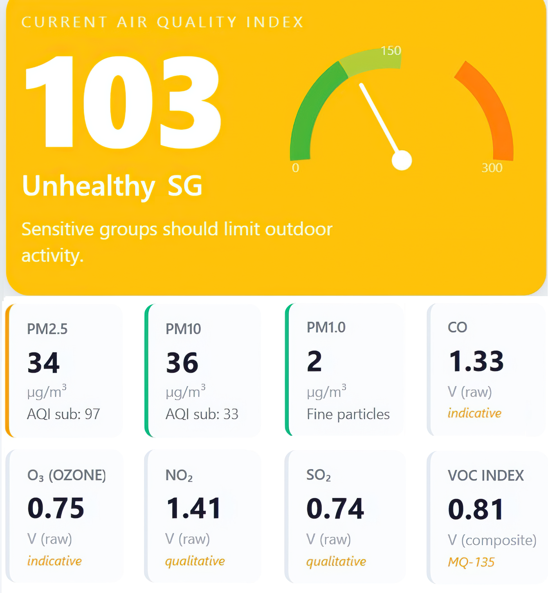
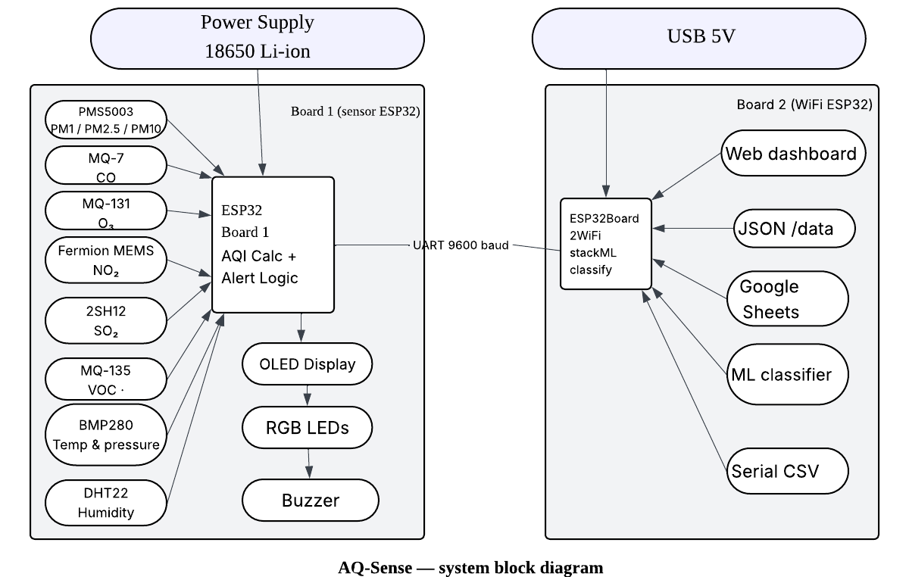
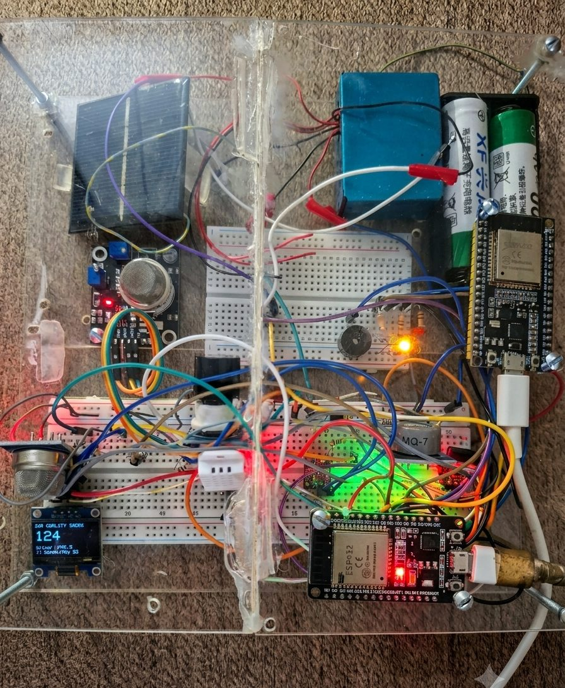
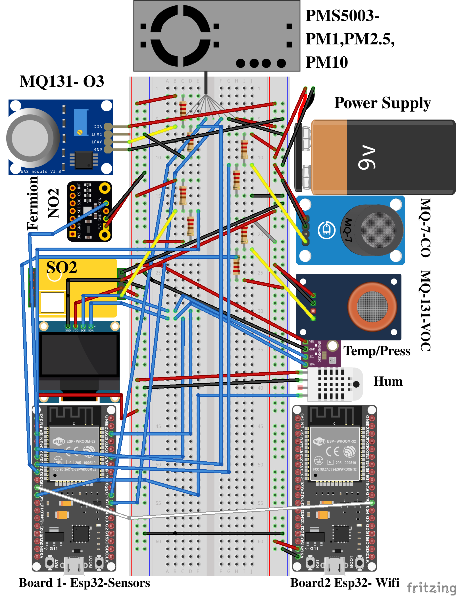
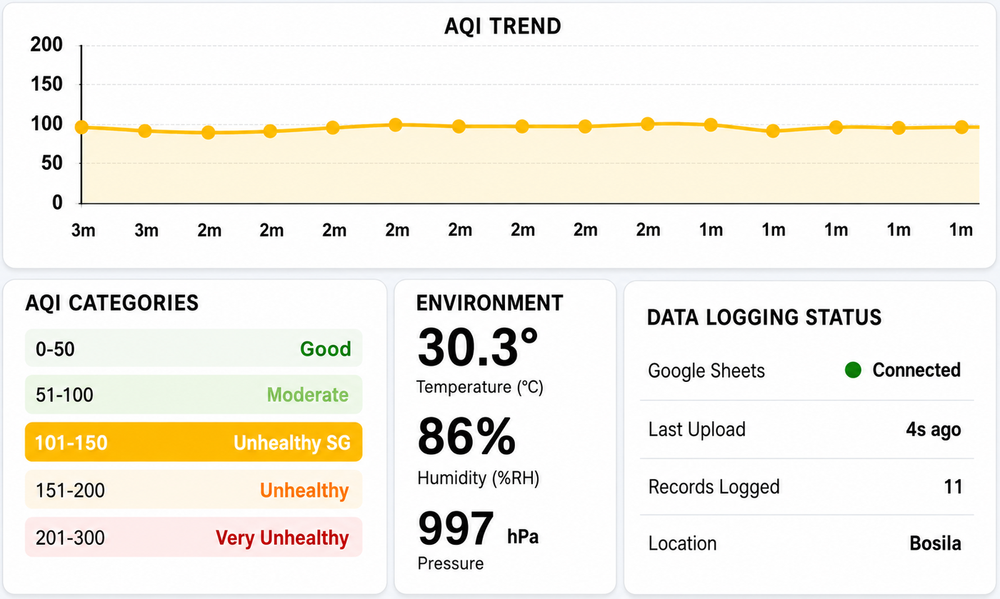
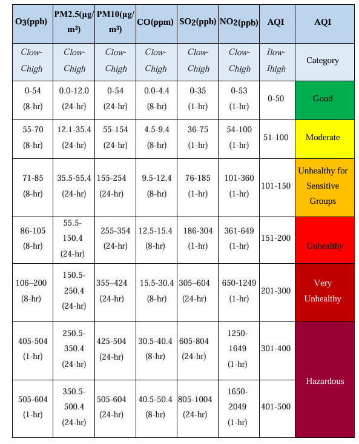

# AQ-Sense — Air Quality Monitoring System for Bangladesh

A low-cost, portable, dual-ESP32 air quality monitor built around the Bangladesh Department of Environment (DoE) AQI standard. Reads six regulated pollutants plus particulates, computes a composite AQI in real time, drives a local OLED + LED + buzzer alert, serves a self-hosted web dashboard, and logs every reading to Google Sheets.

<p align="center">
  
</p>

---

## Table of Contents

- [Overview](#overview)
- [System Architecture](#system-architecture)
- [Hardware](#hardware)
- [Wiring](#wiring)
- [Pin Assignments](#pin-assignments)
- [Live Dashboard](#live-dashboard)
- [Features](#features)
- [AQI Calculation](#aqi-calculation)
- [AQI Categories (Bangladesh DoE)](#aqi-categories-bangladesh-doe)
- [Inter-Board Communication Protocol](#inter-board-communication-protocol)
- [Repository Structure](#repository-structure)
- [Setup & Installation](#setup--installation)
- [Demo Video](#demo-video)
- [Known Limitations](#known-limitations)
- [Roadmap](#roadmap)
- [Acknowledgements](#acknowledgements)

---

## Overview

AQ-Sense measures ambient air quality and reports it according to Bangladesh DoE standards. Work is split across two ESP32 microcontrollers connected by a one-way UART link:

- **Board 1 — Sensor + local UI.** Reads every sensor every 5 seconds, computes a composite AQI across six pollutants (PM2.5, PM10, CO, O₃, NO₂, SO₂), drives a 9-page OLED carousel plus a tri-color LED and piezo buzzer, and streams the measurements to Board 2.
- **Board 2 — Dashboard + logger.** Receives the data, hosts a responsive web dashboard over WiFi, maintains a rolling 24-reading AQI history, and pushes every reading to Google Sheets through an Apps Script webhook.

Splitting sensing from networking keeps the sensor loop deterministic. Board 1 never stalls on a WiFi retry or HTTP timeout.

---

## System Architecture

<p align="center">
  
</p>

Board 1 runs on an 18650 Li-ion battery (with optional solar charging) so it can be deployed portably. Board 2 runs on USB 5V, since it needs stable power for the WiFi radio and HTTPS stack. The two share only the UART line and a common ground.

---

## Hardware

| Category         | Component                        | Purpose                                      |
|------------------|----------------------------------|----------------------------------------------|
| Microcontrollers | 2 × ESP32 DevKit (WROOM-32)      | Sensor board + dashboard board               |
| Particulates     | PMS5003                          | PM1.0, PM2.5, PM10 (factory-calibrated)      |
| CO               | MQ-7                             | Carbon monoxide (analog)                     |
| O₃               | MQ-131                           | Ozone (analog)                               |
| NO₂              | Fermion MEMS NO₂                 | Nitrogen dioxide (analog)                    |
| SO₂              | 2SH12                            | Sulfur dioxide (analog)                      |
| VOC              | MQ-135                           | VOC composite index (analog)                 |
| Climate          | DHT22                            | Temperature + relative humidity              |
| Climate          | BMP280                           | Barometric pressure (I²C)                    |
| Display          | SSD1306 OLED (128×64, I²C)       | Local readout, 9-page carousel               |
| Alerts           | LEDs (green/yellow/red) + buzzer | Instant visual + audible AQI warning         |
| Power (Board 1)  | 18650 Li-ion + solar charger     | Portable, eco-friendly operation             |
| Power (Board 2)  | USB 5V                           | Stable supply for WiFi + HTTPS               |

<p align="center">
  
</p>

---

## Wiring

<p align="center">
  
</p>

The wiring above reflects the prototype as built. A cleaner schematic for documentation and manufacturing is planned.

---

## Pin Assignments

### Board 1 — Sensor Board

| Signal        | ESP32 Pin | Notes                                        |
|---------------|-----------|----------------------------------------------|
| PMS5003 RX    | GPIO 16   | `Serial2` (UART2)                            |
| PMS5003 TX    | GPIO 17   | `Serial2` (UART2)                            |
| DHT22 DATA    | GPIO 27   |                                              |
| SO₂ (2SH12)   | GPIO 34   | ADC input, 12-bit                            |
| CO (MQ-7)     | GPIO 35   | ADC input                                    |
| O₃ (MQ-131)   | GPIO 32   | ADC input                                    |
| VOC (MQ-135)  | GPIO 33   | ADC input                                    |
| NO₂ (Fermion) | GPIO 36   | ADC input                                    |
| LED green     | GPIO 13   | AQI ≤ 100                                    |
| LED yellow    | GPIO 14   | AQI 101–200                                  |
| LED red       | GPIO 12   | AQI > 200                                    |
| Buzzer        | GPIO 25   | Beeps when AQI > 200                         |
| TX → Board 2  | GPIO 26   | `Serial1` TX, 9600 baud                      |
| BMP280        | SDA/SCL   | Default I²C, auto-detects address 0x76/0x77  |
| OLED SSD1306  | SDA/SCL   | I²C address 0x3C                             |

### Board 2 — Dashboard Board

| Signal        | ESP32 Pin | Notes                                        |
|---------------|-----------|----------------------------------------------|
| RX ← Board 1  | GPIO 16   | `Serial2` RX, 9600 baud                      |

Wire Board 1's GPIO 26 (TX) to Board 2's GPIO 16 (RX) and share a common ground between the two boards.

---

## Live Dashboard

Board 2 hosts a responsive single-page dashboard on port 80. Any browser on the same WiFi can open it at the IP printed on the serial monitor at boot.

The top of the dashboard shows the current AQI, a color-coded SVG gauge, the dominant pollutant, and per-pollutant readings:

<p align="center">
  
</p>

Below that, a 24-reading AQI trend chart, the DoE category legend, environmental conditions, and Google Sheets logging status:

<p align="center">
  
</p>

---

## Features

- Real-time AQI, updated every 5 seconds on the local OLED
- Composite AQI across six pollutants (PM2.5, PM10, CO, O₃, NO₂, SO₂) — reports the dominant pollutant alongside the overall AQI
- Tri-color LED + buzzer for at-a-glance health status
- Self-hosted web dashboard with live gauge, pollutant breakdown, 24-reading trend chart, and environmental conditions
- Long-term logging to Google Sheets every 60 seconds via Apps Script webhook
- Board 1 is portable (18650 Li-ion + solar); Board 2 runs on USB
- WiFi auto-reconnect; the sensor loop keeps running even if the network drops

---

## AQI Calculation

AQI is computed per the standard USEPA breakpoint formula adopted by Bangladesh DoE:

```
AQI = ((I_high − I_low) / (C_high − C_low)) × (C − C_low) + I_low
```

The firmware calculates a sub-index for each pollutant and reports the **maximum** as the overall AQI, with the driving pollutant surfaced in the UI.

### Full breakpoint table

<p align="center">
  
</p>

Each sub-index maps onto the same 0–500 AQI scale. Averaging times follow the DoE / USEPA convention shown above.

---

## AQI Categories (Bangladesh DoE)

| AQI Range | Category                       | Colour       | Health Advice                                           |
|-----------|--------------------------------|--------------|---------------------------------------------------------|
| 0–50      | Good                           | Green        | Air is clean. Enjoy outdoor activities.                 |
| 51–100    | Moderate                       | Yellow-Green | Acceptable. Sensitive people should take care.          |
| 101–150   | Unhealthy for Sensitive Groups | Yellow       | Sensitive groups should limit outdoor activity.         |
| 151–200   | Unhealthy                      | Orange       | Reduce outdoor activity. Wear a mask.                   |
| 201–300   | Very Unhealthy                 | Red          | Avoid outdoors. Use a mask if going out.                |
| 301–500   | Hazardous                      | Purple       | Stay indoors. Health emergency.                         |

---

## Inter-Board Communication Protocol

Board 1 sends one newline-terminated frame to Board 2 every 5 seconds. Fields are pipe-delimited:

```
<AQI>|<CAT>|<PM2.5>|<PM10>|<PM1>|<CO_V>|<O3_V>|<NO2_V>|<SO2_V>|<VOC_V>|<TEMP>|<HUM>|<PRES>
```

Example:

```
103|Unhealthy_SG|34|36|2|1.33|0.75|1.41|0.74|0.81|30.3|86|997
```

- AQI is an integer; CAT is a short category label
- Particulate values are µg/m³
- Gas sensor fields carry **raw ADC voltage** (see Known Limitations)
- Temperature °C, humidity %RH, pressure hPa

Board 2 trusts Board 1's AQI value and re-derives the category from it for consistency.

---

## Repository Structure

```
aq-sense/
├── firmware/
│   ├── board1_sensor/
│   │   └── board1_sensor.ino           # Sensor reading, AQI calc, OLED, LEDs
│   └── board2_dashboard/
│       ├── board2_dashboard.ino        # WiFi, web server, Sheets logger
│       ├── secrets.h                   # NOT committed — WiFi creds + Sheet URL
│       └── secrets.example.h           # Template committed to repo
├── docs/
│   └── images/
│       ├── 01-system-architecture.png
│       ├── 02-aqi-breakpoints.png
│       ├── 03-dashboard-trend.png
│       ├── 04-dashboard-main.png
│       ├── 05-wiring-diagram.png
│       └── 06-hardware-photo.jpg
├── .gitignore
└── README.md
```

---

## Setup & Installation

### Prerequisites

- Arduino IDE 2.x (or PlatformIO)
- ESP32 board package: `https://raw.githubusercontent.com/espressif/arduino-esp32/gh-pages/package_esp32_index.json`
- Libraries (install via Library Manager):
  - `Adafruit GFX`
  - `Adafruit SSD1306`
  - `Adafruit BMP280`
  - `DHT sensor library` (Adafruit)

### Flash Board 1 (Sensor Board)

1. Open `firmware/board1_sensor/board1_sensor.ino` in Arduino IDE.
2. Select board: **ESP32 Dev Module**.
3. Connect the ESP32 via USB and select the correct COM port.
4. Upload.

### Flash Board 2 (Dashboard Board)

1. In `firmware/board2_dashboard/`, copy `secrets.example.h` to `secrets.h`.
2. Fill in your WiFi SSID, password, and Google Apps Script deployment URL.
3. Open `board2_dashboard.ino`, select **ESP32 Dev Module**, and upload.
4. Open the Serial Monitor at 115200 baud. Board 2 prints its IP address on boot, e.g. `http://192.168.1.42`.

### Wire the Two Boards

- Board 1 GPIO 26 (TX) → Board 2 GPIO 16 (RX)
- Board 1 GND ↔ Board 2 GND (shared ground is required)

### Open the Dashboard

From any device on the same WiFi: `http://<ip-shown-in-serial-monitor>`

---

## Demo Video

A short demo of the system running live, with the dashboard and OLED pages cycling:


https://github.com/user-attachments/assets/f2928d24-dde4-434d-9b15-517575937de7


---

## Known Limitations

An honest statement of what this build does and does not deliver:

- **Gas sensors (CO, O₃, NO₂, SO₂) report raw ADC voltage, not calibrated ppm/ppb.** Converting MQ-series and MEMS readings into absolute concentrations requires per-sensor lab calibration against a reference instrument, temperature and humidity compensation, and a long burn-in period. The firmware applies linear baseline-subtraction constants purely to feed the AQI formula so the system produces a usable composite number. **Do not cite the individual gas concentrations as measurement-grade values in a paper without a calibration study to back them.**
- **PM2.5 and PM10 are reliable** — the PMS5003 is factory-calibrated by laser scattering.
- **Temperature and humidity are consumer-grade** (DHT22: ±0.5 °C, ±2–5 %RH).
- The web dashboard is HTTP only with no authentication. Keep it on a trusted LAN.
- There is no on-device clock. Timestamps are added by Google Sheets on receipt.
- The current prototype uses breadboard wiring. A PCB or at least a proto-board build is needed for field deployment.

---

## Roadmap

- **ML classifier (in progress):** a decision-tree model trained on a Bangladesh AQI dataset (~1M rows, 2000–2025) will run on Board 2 to classify the overall air quality class. The hooks already exist in `handleRoot()` and `parseData()` and are commented out pending model finalization.
- Calibration study for gas sensors against a reference monitor
- Offline data buffering for WiFi outages
- OTA firmware update
- Clean KiCad schematic + PCB

---

## Acknowledgements

Developed at the **Department of Computer Science and Engineering, University of Liberal Arts Bangladesh (ULAB)**.

AQI breakpoints follow USEPA conventions as adopted by Bangladesh DoE (NAQMP 2024–2030).

## License

## License

This project is released under the MIT License — see the [LICENSE](LICENSE) file for the full text.

You are free to use, copy, modify, and distribute the firmware and documentation, including for commercial purposes, as long as the original copyright notice is kept. The software is provided "as is" without warranty.
